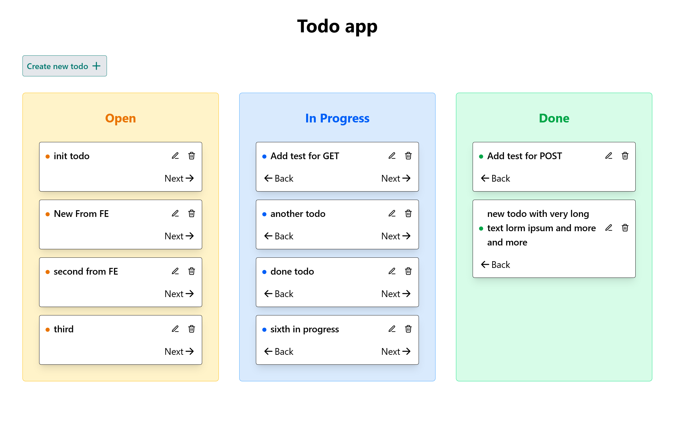

# Todo App – Frontend

<p>
  
  
</p>

A simple Kanban-style todo board built with React, TypeScript and Tailwind CSS. It talks to a Spring Boot REST API via Axios.



## Features

- Three columns: **Open**, **In Progress**, **Done**
- Create, edit and delete todos (with confirmation)
- Move todos forward and back between columns
- Loading and error states for fetching and saving

## Tech stack

| | |
|---|---|
| UI | React + TypeScript |
| Styling | Tailwind CSS |
| HTTP | Axios |
| Build | Vite |
| Backend | Spring Boot REST API (`/api/todo`) |

## Getting started

```bash
npm install
npm run dev
```

The backend must be running. Requests to `/api` are proxied to it by the Vite dev server.

## Scripts

| Command | Description |
|---|---|
| `npm run dev` | Start the dev server |
| `npm run build` | Build for production |
| `npm run format` | Format code with Prettier |